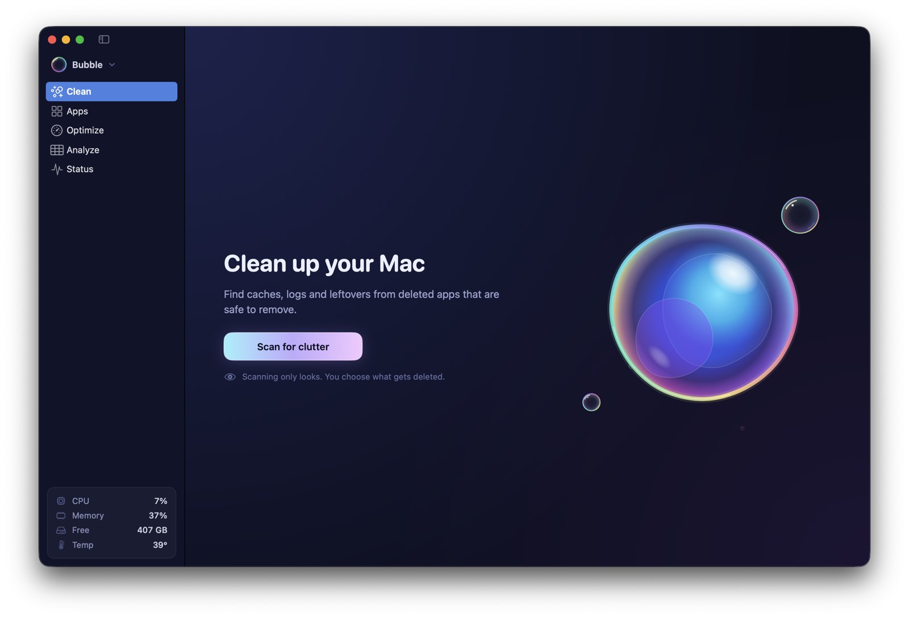
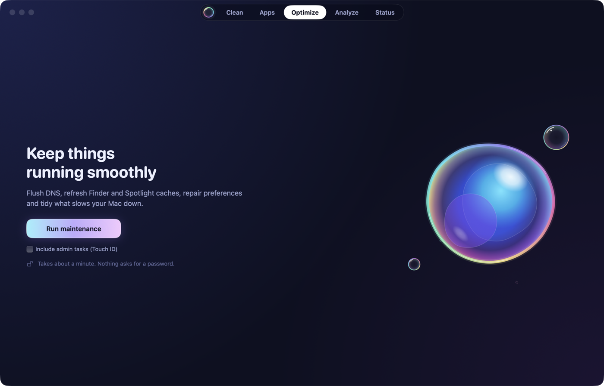
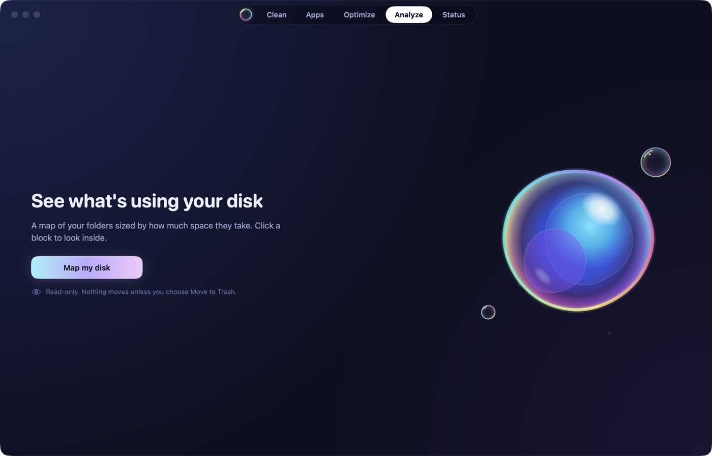

<p align="center">
  
</p>

<h1 align="center">Bubble</h1>

<p align="center">A free, native Mac app for <a href="https://github.com/tw93/Mole">Mole</a>, the open-source Mac cleaner.</p>

<p align="center">
  
</p>

<p align="center">
  
  
</p>

Bubble puts a friendly window on top of Mole's `mo` command-line tool: clean caches, uninstall apps
with their leftovers, run maintenance, map your disk and watch your Mac's vitals. Every cleanup
runs `mo`, so Mole's safety rules, protected items and history apply exactly as they do in
Terminal. The one exception is uninstalling apps, which Bubble does natively (see below).

## Install

1. Download `Bubble-X.Y.Z.zip` from the [latest release](https://github.com/jainnitin/bubble/releases/latest),
   unzip it and drag **Bubble** to Applications.
2. Open it. If Mole isn't installed yet, Bubble installs it for you.
3. Give Bubble **Full Disk Access** when it asks, so Mole can scan everything.

Bubble is signed and notarized by Apple and updates itself.

## Features

| Section | What it does |
|---|---|
| **Clean** | Runs `mo clean --dry-run`, then reads `~/.config/mole/clean-list.txt` so you can review and untick items before `mo clean`. Unticked items are protected for that one run by temporarily adding them to `~/.config/mole/whitelist` (restored right after, or on the next launch if Bubble quit mid-clean). |
| **Apps ▸ Uninstall** | Native, no `mo`. Lists apps in `/Applications` and `~/Applications` (Apple and protected apps are hidden). Leftovers are matched by exact bundle id, or by exact app name in a few `~/Library` folders, and shown before anything is removed. Open apps are asked to quit. Homebrew casks are removed with `brew uninstall --cask --zap`; everything else goes to the Trash. System files (for example in `/Library/LaunchDaemons`) are moved after one macOS authorization prompt, which accepts Touch ID. Without Full Disk Access, other apps' containers are only checked by exact path, never read or measured. |
| **Apps ▸ Updates** | Homebrew casks (`brew outdated --cask --greedy`), the App Store lookup API and Sparkle appcasts. Homebrew apps update in place; the rest open the App Store or the download page. |
| **Apps ▸ Startup** | Launch agents and daemons from `~/Library/LaunchAgents`, `/Library/LaunchAgents` and `/Library/LaunchDaemons`. Your agents can be switched on and off with `launchctl`; daemons are view-only. |
| **Optimize** | `mo optimize`, with live progress per task. |
| **Analyze** | `mo analyze --json PATH`, drawn as a treemap you can drill into. Right-click to reveal, copy the path or move to the Trash. |
| **Status** | `mo status --watch` (one JSON line per second) plus native readings: CPU and GPU temperatures and fan speed from the SMC, GPU use from IOKit, and the full process list with Quit and Force Quit. A compact version lives in the menu bar. |

Also:

- **First-run setup** installs or updates Mole for you (see Requirements) and asks for Full Disk Access.
- **Checkup** (Bubble menu at the top of the sidebar) checks Mole, permissions, Touch ID for sudo,
  free disk space and Mole's health score, with a fix for each problem.
- **Settings**: Full Disk Access status, open at login, menu-bar-only mode, open straight to
  results, the Protected Items editor for Mole's whitelist, the menu bar display, and Mole's
  version and updates.
- **Keep Screen On** and **Clean Screen** (a black screen to wipe it), from the Bubble menu.

Optimize runs inside a pseudo-terminal so `sudo` works: when Mole needs admin rights,
Bubble shows a password field and types it into sudo's prompt. Every other prompt Mole shows is
declined with a safe answer and listed as "Skipped".

## Requirements

- macOS 14 or later.
- Mole 1.59.0 or later. You don't need to install it first: on first launch Bubble installs it with
  Homebrew (`brew install mole`) when Homebrew is there, otherwise with Mole's official install
  script, pinned to a release and checked against a SHA-256 built into Bubble. It installs into
  `~/.local/bin` and never asks for an administrator password. An older Mole is offered an update.
- To build: Xcode. The Command Line Tools alone can't expand SwiftUI's `@State` and `@Observable`
  macros.

## Building and developing

```sh
scripts/bundle.sh            # release build: build/Bubble.app, Developer ID (else ad-hoc), hardened runtime
scripts/bundle.sh --install  # also copies it to /Applications
DEVELOPER_DIR=/Applications/Xcode.app/Contents/Developer swift build   # debug build
DEVELOPER_DIR=/Applications/Xcode.app/Contents/Developer swift test    # unit tests
```

Give Bubble **Full Disk Access** (System Settings ▸ Privacy & Security) so Mole can see the Trash,
Mail and other protected caches.

Some tests run real processes in a pseudo-terminal (bash scripts standing in for Mole). The test
that needs an installed Mole skips itself without one; `BUBBLE_LIVE_MOLE=1 swift test --filter
LiveMoleTests` runs a read-only `mo uninstall --dry-run` through the prompt handling.

**Dev builds.** `BUBBLE_DEV=1 scripts/bundle.sh` compiles in debug hooks that release builds don't
contain (`release.sh` refuses to ship them). Pass them as launch arguments, for example
`open build/Bubble.app --args -simulateNoMole YES`:

| Argument | Effect |
|---|---|
| `-simulateNoMole YES` | Mole reported missing (welcome screen) |
| `-simulateNoBrew YES` | Homebrew reported missing (install-script route) |
| `-simulateMoleVersion 1.40.0` | Report this Mole version (update screen) |
| `-simulateInstallFailure YES` | The simulated install fails (error screen) |
| `-simulateNoFullDiskAccess YES` | Full Disk Access reported off (access step) |
| `-lastTab Status`, `-appsSub Updates` | Open on a section |
| `-autoStart YES` | Clean and Analyze start their read-only scan on launch |

While any `-simulate…` argument is set, installing or updating Mole is a dry run with canned
output. `scripts/shot.sh <Tab> out.png` relaunches a dev build on a section and screenshots its
window (check the image before sharing it: Status shows your IP address, processes and devices).

The app icon is drawn in code; see [scripts/icon/README.md](scripts/icon/README.md).

## Privacy

Bubble has no analytics, telemetry or crash reporting, and no account.

**Network.** Bubble itself only goes online for these:
- **Its own updates.** Sparkle fetches `appcast.xml` from GitHub Releases once a day (turn
  this off under **Settings ▸ Mole ▸ Automatically check for updates**), or when you choose
  **Check for Updates…**. It sends no information about your Mac.
- **Apps ▸ Updates**, only when you open it: the App Store lookup API (`itunes.apple.com`, with
  your App Store apps' bundle IDs), each Sparkle-based app's own update feed, and
  `brew outdated` for Homebrew casks. These requests send no cookies and a generic User-Agent.
- **Explicit actions**: installing or updating Mole (Homebrew, or Mole's install script from
  GitHub), updating a Homebrew app, and the "is Mole up to date" check in Checkup and Settings,
  which asks Homebrew.

**Your admin password** is typed into `sudo`'s prompt once, when Mole asks for it during
Optimize or Uninstall. Bubble never saves it, in the Keychain or anywhere else, and scrubs it
from the output it shows in case the terminal echoes it.

**Permissions**
- *Full Disk Access* (optional) lets Mole see the Trash, Mail and other protected caches. macOS
  extends it to the tools Bubble runs: `mo`, `brew`, and developer tools such as `npm`, `pip` and
  `go` that Clean asks to clear their caches.
- *Administrator password* for the tasks above.
- *Automation*: some of Mole's steps use `osascript` (listing running apps through System Events,
  removing an uninstalled app's login items, moving files to the Trash through Finder), so macOS
  may ask whether Bubble can control Finder or System Events.
- *Open at login*, only if you turn it on in Settings.

**On disk**, Bubble writes only:
- its preferences (the `~/Library/Preferences/` plist for Bubble's bundle ID);
- `~/.config/mole/whitelist`, when you edit Protected Items, and temporarily during a selective
  clean (with a backup beside it, restored right after, or on the next launch if Bubble quit
  mid-clean);
- Mole's own files, as `mo` writes them: `~/.config/mole/clean-list.txt` from each scan, and
  Mole's history and logs.

## Updates

Bubble updates itself with [Sparkle 2](https://sparkle-project.org). It checks once a day (or
**Bubble ▸ Check for Updates…**), reads `appcast.xml` from the newest GitHub Release, and installs
an update only if the zip's EdDSA signature matches the public key built into the app. The appcast
is signed too (`SURequireSignedFeed`). Releases are signed with Developer ID and notarized by
Apple, so they open without a Gatekeeper warning and keep their Full Disk Access grant across
updates.

## Releasing

Settings live in `updates.conf` (repo, feed URL, public key, Keychain account) and `VERSION`.
`CFBundleVersion` is derived from the version (`1.2.3` → `1002003`), so every new version is newer
to Sparkle.

One-time setup:

1. Set `GITHUB_REPO` in `updates.conf` to the real `owner/repo`. The feed URL is derived from it:
   `https://github.com/<owner>/<repo>/releases/latest/download/appcast.xml`.
2. The EdDSA private key is in the login Keychain as "Private key for signing Sparkle updates",
   account `bubble`. Its public half is `SU_PUBLIC_ED_KEY` in `updates.conf`. Export the private key
   into the release secret, then delete the exported file:
   ```sh
   swift package resolve   # fetches Sparkle's tools into .build/artifacts
   .build/artifacts/sparkle/Sparkle/bin/generate_keys --account bubble -x ~/bubble_ed25519
   gh secret set SPARKLE_ED_PRIVATE_KEY --env release < ~/bubble_ed25519 && rm -P ~/bubble_ed25519
   ```
3. The secret lives in a GitHub environment named `release` (Settings ▸ Environments), not in the
   repo-wide secrets. Give that environment a deployment rule limited to tags matching `v*.*.*`
   (and ideally a required reviewer), so no other branch or workflow can read the key.
4. Keep a backup of the private key (for example in a password manager). Without it, existing
   installs can't be updated.
5. Add the Apple secrets to the same `release` environment (the same values as `~/code/keel`):
   `MACOS_CERT_P12_BASE64` and `MACOS_CERT_PASSWORD` (the Developer ID Application certificate),
   and `APPLE_API_KEY_P8_BASE64`, `APPLE_API_KEY_ID`, `APPLE_API_ISSUER_ID` (an App Store Connect
   API key, used to notarize).
6. For local releases, save the notary credentials once:
   `xcrun notarytool store-credentials bubble --key <AuthKey.p8> --key-id <ID> --issuer <issuer>`.

To cut a release, bump `VERSION`, commit, then `git tag v$(cat VERSION) && git push --tags`.
`.github/workflows/release.yml` runs `scripts/release.sh` in the `release` environment: it builds
the app, signs it with Developer ID, notarizes and staples it, zips it with `ditto`, signs the zip, writes a signed `appcast.xml` with Sparkle's
`generate_appcast`, and checks the signature against `SU_PUBLIC_ED_KEY`. A separate job without
the key then attaches both files to the GitHub Release. If `release-notes/X.Y.Z.md` exists, it
appears in the update dialog. To build a release locally with the Keychain key, run
`scripts/release.sh` (the output goes to `dist/`); `SKIP_NOTARIZE=1` skips notarization for a
test build.

Builds use the hardened runtime with the `com.apple.security.automation.apple-events` entitlement
(Mole runs `osascript`, and macOS checks Bubble for it). `scripts/bundle.sh` signs with the first
Developer ID Application identity in your keychains (override with `SIGN_IDENTITY`, or `-` for
ad-hoc). Ad-hoc builds also set `cs.disable-library-validation`, because without a Team ID the
hardened runtime won't load Sparkle.framework; Developer ID builds keep library validation on.

CI (`.github/workflows/ci.yml`) builds with and without the debug hooks and runs the tests on
every push and pull request.

## Architecture

A Swift package with one executable target; `scripts/bundle.sh` wraps it into an app bundle with
Sparkle.framework. Each section is a SwiftUI view over an `@Observable` model, and every screen
stays alive while hidden so scans and running jobs survive switching sections.

```
Sources/Bubble/
  App.swift              app, window, sidebar, menu bar item, commands
  Core/
    Shell.swift          runs child processes: fixed mo/brew paths, scrubbed environment,
                         system-first PATH, executable trust check, line streaming
    PTY.swift            pseudo-terminal sessions, the sudo password dialog and prompt policy
    Safety.swift         pure guards: Move to Trash, uninstall matching, command arguments, links
    Theme.swift          palette, type scale, spacing, motion and shared modifiers
    Components.swift     shared views: cards, buttons, hero layout, log box, section header
    Bubble.swift         the bubble artwork (SwiftUI, and Core Animation for the hero)
    Doctor.swift         Checkup
    Updater.swift        Sparkle
    Utilities.swift      Keep Screen On, Clean Screen, System Settings, Finder, clipboard
    Format.swift         sizes, rates, dates and paths
  Onboarding/            Mole detection, install and update, and the setup screens
  Clean/                 scan parsing, selection rules, the temporary whitelist
  Apps/                  Uninstall, Updates (appcasts, version comparison), Startup
  Optimize/              mo optimize
  Analyze/               navigation model, view and squarified treemap
  Status/                mo status model, native sensors (SMC, GPU, processes), cards, menu bar panel
  Settings/              the window and its panes, including the Protected Items editor
Tests/BubbleTests/       unit tests, plus pseudo-terminal tests with scripted prompts
scripts/                 bundle.sh, release.sh, verify-update.swift, shot.sh, icon/
```

## Known limits

- System-level caches in **Clean** need admin rights, and Mole only uses an already-open sudo
  session for those. Run `sudo -v && mo clean` in Terminal for them.
- Mole's clean rescans when it runs, so anything new since your preview is cleaned too, the same
  as `mo clean`.
- No AI-tool cleanup, fan control or privacy indicators; the CLI doesn't expose them.

## Credits and license

Bubble is released under the [MIT License](LICENSE).

- [Mole](https://github.com/tw93/Mole) by tw93 is licensed under GPL-3.0. Bubble runs the `mo`
  you have installed as a separate program and doesn't bundle or link any of its code.
- [Sparkle](https://sparkle-project.org) (MIT) is embedded for self-updates.
- The app icon and bubble artwork are drawn in code (`scripts/icon/`, `Sources/Bubble/Core/Bubble.swift`);
  there is no third-party art.

Bubble is a separate project from Mole for Mac, the native app by Mole's author.
